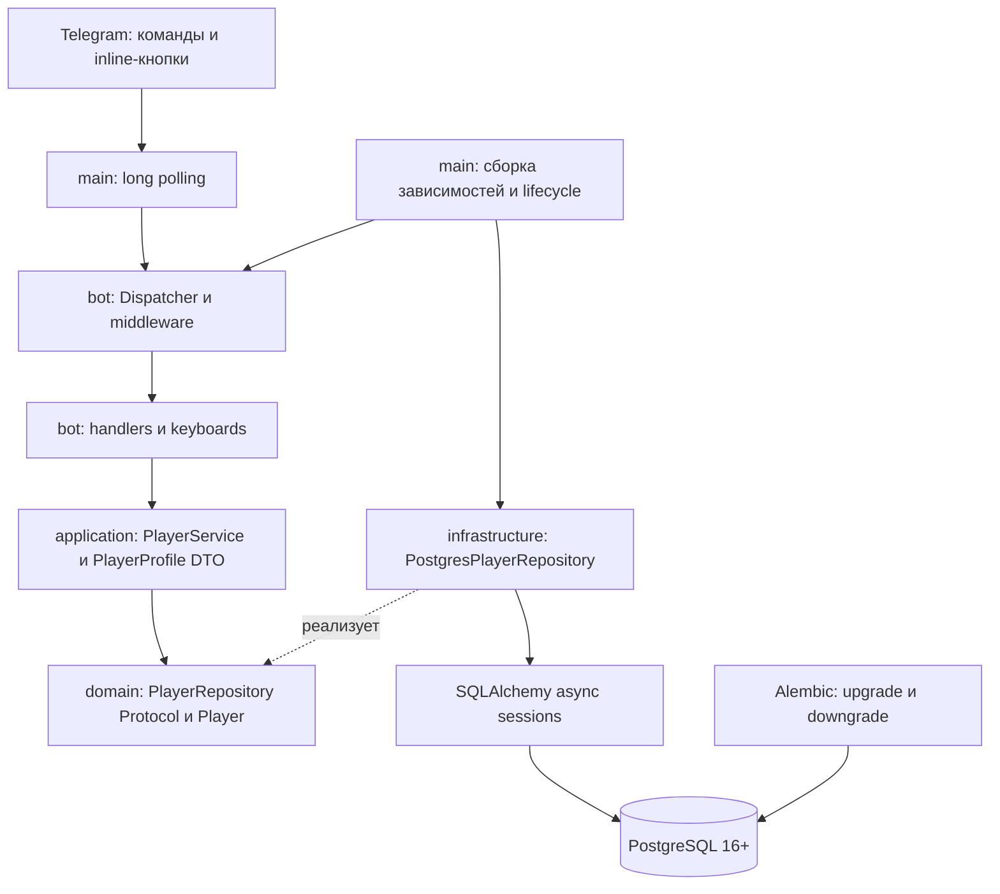

> Историческое описание фундамента. Текущая реализация карточек: [v0.2.0](v020-report.md); роль card_templates выполняет characters, экземпляры — owned_cards, валюта — wallets и currency_transactions.

# Архитектура CardLegends

## Модульный монолит

`domain` не импортирует Telegram, Pydantic или SQLAlchemy. Здесь находятся неизменяемая сущность игрока, контракт репозитория и ошибка хранилища. `application` организует сценарии регистрации и получения собственного профиля; DTO определяет данные ответа, но не Telegram-разметку.

`infrastructure` реализует контракт, управляет сессиями, настройками и JSON-логами. `bot` форматирует русский текст, безопасно экранирует HTML, маршрутизирует команды и подтверждает callback. SQL в обработчиках отсутствует. `main` собирает зависимости и владеет жизненным циклом ресурсов.

Middleware передаёт сервис через aiogram DI, устанавливает correlation ID в ContextVar на время update и обрабатывает ошибки без раскрытия их содержания. На каждый вызов репозитория создаётся отдельная AsyncSession; общий сервис не хранит изменяемое состояние игрока или открытую транзакцию.

## Хранение и транзакции этапа 1

Таблица players: UUID PK, BIGINT telegram_id с уникальным ограничением, публичное имя и необязательный username, даты создания, обновления и последнего посещения с часовым поясом. UUID создаёт Python; часы БД задают временные метки. Telegram ID — единственный внешний идентификатор. Повторяющиеся и меняющиеся username допустимы.

Регистрация — один PostgreSQL `INSERT ... ON CONFLICT ON CONSTRAINT uq_players_telegram_id DO UPDATE ... RETURNING` в транзакции. Существующие id и created_at не меняются; display_name, username, updated_at и last_seen_at обновляются. Удалённый пользователем username записывается как NULL. Блокировку конкурирующих upsert обеспечивает PostgreSQL, предварительного SELECT и внутрипроцессного lock нет. Успешный ответ сервиса возвращается после commit.

Чтение профиля всегда фильтруется по ID отправителя Telegram, а не по параметру команды или callback. Команда доступна в личном чате; callback отправляет профиль лично. Сохранение проверено после закрытия engine и создания нового подключения к той же БД.

Бот использует только CONNECT/USAGE и SELECT/INSERT/UPDATE на players. Мигратор получает отдельный DSN владельца схемы. На этапе 1 права на удаление, изменение структуры или alembic_version боту не выдаются. Для внешнего PostgreSQL роли и ограничения создаёт администратор. Доступ к БД в Compose не публикуется на хост.

## Жизненный цикл и транспорт

AsyncExitStack закрывает bot.session и engine даже при ошибке запуска или polling. Перед регистрацией Telegram-команд бот проверяет доступность players; миграции выполняются отдельным процессом до старта бота. Параметры asyncpg ограничивают установку соединения и выполнение SQL пятью секундами.

`create_dispatcher(service)` не зависит от polling. Для будущего webhook можно подключить тот же Dispatcher к HTTP-адаптеру, отдельно добавив проверку webhook secret, HTTPS и правила повторной доставки. Сам HTTP-сервер и webhook сейчас не реализованы. Для polling требуется один процесс на токен. Гарантии exactly-once доставки Telegram-сообщений нет: повторный update может повторить приветствие, но не создаст второго игрока.

## Расширение: карточки и коллекция

Будущая таблица **card_templates** содержит каталог: стабильный ID шаблона, название, редкость, базовые характеристики, ссылки на изображения, версию правил. **player_cards** хранит отдельные экземпляры: собственный UUID, player_id, template_id, индивидуальный прогресс и даты получения. Владение не должно храниться в шаблоне; изменение каталога не должно незаметно перезаписывать характеристики уже выданного экземпляра. Политику версионирования следует согласовать на этапе 2.

Сценарии каталога и коллекции добавляются в application, контракты владения — в domain, таблицы и запросы — в infrastructure, пагинация и карточки сообщений — в bot. Новые таблицы создаются новыми миграциями. До согласования этапа 2 эти сущности, миграции и обработчики не создаются.

## Расширение: валюты и призыв

Изменения валют должны проходить через **транзакционный ledger**: неизменяемые записи с player_id, видом валюты, суммой, причиной и уникальным ключом идемпотентности операции. Списание, запись ledger и выдача экземпляра карточки должны атомарно фиксироваться в одной транзакции. Баланс можно вычислять по ledger или хранить согласованный кэш с блокировкой/проверкой неотрицательности. Простое изменение поля баланса без истории не подходит. Правила случайности, аудит и ограничения согласовываются отдельно; реальных платежей здесь нет.

## Расширение: сражения

Боевой движок должен быть чистым и независимым от Telegram/БД: состояние + действие + управляемый источник случайности → новое состояние + события. Он валидирует допустимость хода, порядок действий и условия завершения. Фиксированный seed или внедряемый RNG позволит воспроизводить бой в тестах. Application отвечает за загрузку и атомарное сохранение состояния/версии боя, Telegram-адаптер — только за выбор действий и представление результата. PvE/PvP не должны формировать собственные несогласованные версии правил в handlers.

## Проверки и ограничения

Модульные тесты проверяют сервисы, русское представление, маршрутизацию, HTML, безопасные ошибки и закрытие ресурсов. Записи Telegram API перехватываются RecordingSession; сетевой вызов в таком тесте является ошибкой. Интеграционные тесты работают на PostgreSQL 16, прогоняют upgrade/downgrade и сравнивают ORM с миграцией. Для тестирования чистая БД обязательна; SQLite не подменяет PostgreSQL upsert.

Нет реализации игровой экономики, каталога, боя, обменов, платежей, webhook или production-инфраструктуры. Расширения выше являются проектными границами, а не действующими функциями.
